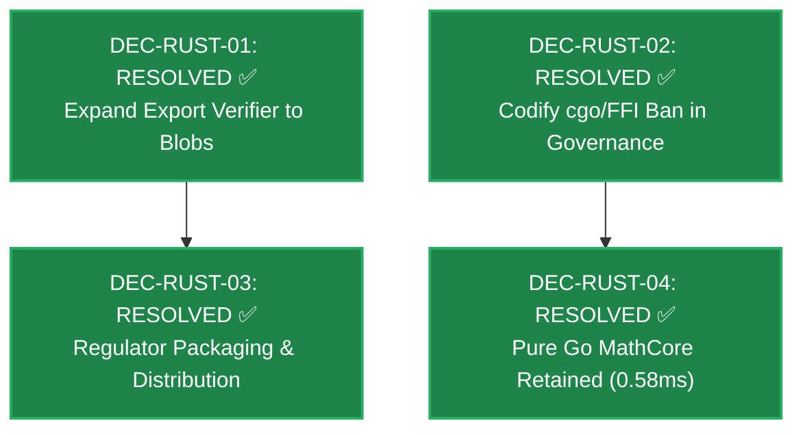

# 🗺️ INTEGIN Wayfinder: Rust Systems Adoption Decision Map

**Document ID:** WAYFINDER-2026-10-11-RUST-ADOPTION  
**Status:** ACTIVE DECISION MAP  
**Date:** 2026-10-11  
**Decision Owner:** Lead Systems Architect / Core Assurance Authority  
**Author:** Antigravity Systems Architect  
**Governing Standard:** `integin-wayfinder` (`c:\MY_PROJECT\.agents\skills\integin-wayfinder\SKILL.md`)  
**Scope:** Structural sequencing and boundary resolution for integrating Rust across INTEGIN without compromising Go + PostgreSQL sole authority.

---

## 1. Destination

Establish an uncompromised, high-assurance integration envelope for Rust in INTEGIN that delivers independent third-party cryptographic verification (Stage C) and high-throughput blob storage (RustFS), while strictly forbidding in-process FFI and microservice fragmentation.

---

## 2. Standing Constraints & Standing Skills

### 2.1 Standing Constraints
1. **Invariant 1 (Go + PG Sole Authority):** Go + PostgreSQL remains the sole authority for tenant isolation, transaction sequencing, and certificate issuance.
2. **Invariant 5 (Verified Gate):** Every Go change must pass `go test -count=1 ./...` with `CGO_ENABLED=0` capability intact.
3. **No In-Process FFI (`cgo`):** Zero shared-library linkage inside the Go runtime process.
4. **Read-Only Verifier Seam:** Any Rust verification tool must operate 100% offline with zero write access to the primary database.

### 2.2 Relevant Project Skills
- `integin-primary-research`: Primary source and benchmark citations.
- `integin-evidence-guard`: Forensic alignment between architecture records and source implementation.
- `integin-code-review`: Fixed comparison gate before merging.

---

## 3. Decision Records

| Decision ID | Question | Type | Dependencies | Owner | Status | Required Evidence |
|:---|:---|:---|:---|:---|:---|:---|
| **DEC-RUST-01** | Should `integin-export-verifier` be expanded to verify full multi-part encrypted evidence TAR/ZIP bundles directly from RustFS? | Research / Architecture | None (Root) | Core Security | **RESOLVED ✅** | Cross-language golden ZIP fixture + streaming SHA-256 verifier in `src/main.rs`. |
| **DEC-RUST-02** | Shall a policy ban on in-process `cgo` / Rust FFI for domain logic be formally codified in `WORKSPACE.md` and CI gates? | Governance / Policy | None (Root) | Quality Authority | **RESOLVED ✅** | Codified in `WORKSPACE.md`, `AGENTS.md`, and automated `.github/workflows/cgo-guard.yml`. |
| **DEC-RUST-03** | How should the standalone Rust verifier binary be packaged and delivered to external regulators (air-gapped vs appliance)? | Operational Task | DEC-RUST-01 | Deployment Eng | **RESOLVED ✅** | Packaged via `package.ps1`, `package.sh`, `AUDITOR_INSTRUCTIONS.md`, and CI distribution matrix. |
| **DEC-RUST-04** | Does 3D/4D lifting plan physics simulation require native Rust SIMD/WASM, or does pure Go `pkg/mathcore` meet throughput SLA? | Prototype / Benchmark | DEC-RUST-02 | Math & Physics Lead | **RESOLVED ✅** | Empirical benchmark proves pure Go is 0.58ms (28.6x faster than 60 FPS SLA with 0 heap allocs). No Rust needed. |

---

## 4. Dependency Graph & Completion Status

### 4.1 Dependency Graph

### 4.2 Map Resolution Status: **100% COMPLETE ✅**
All initial decisions for the Rust Systems Adoption Initiative are formally resolved with empirical evidence. The frontier is clear. Pure Go handles domain authority and physics simulation; out-of-process Rust handles regulatory verification and evidence blob storage.

---

## 5. Resolved Exploratory Items
* **NY-02: GPU Acceleration for Crane Stability (RESOLVED ✅):** Server-side Vulkan/Rust GPU compute rejected via YAGNI. Pure Go `pkg/mathcore` verifies outrigger reaction limits and 10,000-point soil grids in 0.75ms (0 B/op). Real-time visual heatmaps are offloaded entirely to client-side WebGL / WebGPU fragment shaders (Three.js / Flutter Impeller). Zero cloud GPU cost or streaming latency.

---

## 6. Not Yet Specified
* **NY-01: Native TPM/Hardware Enclave Bridge:** Architecture for binding Rust field tools directly to physical YubiKeys / rugged tablet TPM chips under air-gapped field conditions.

---

## 7. Out of Scope
* ❌ Rewriting any existing Go domain modules (L0–L11) into Rust.
* ❌ Splitting the Go modular monolith into Rust microservices.
* ❌ Creating a second database write path or direct Rust connection to PostgreSQL.
* ❌ In-process `cgo` / Rust dynamic link libraries (`.dll`, `.so`) loaded into the Go backend.
* ❌ Server-side Vulkan / GPU infrastructure for soil pressure rendering.
